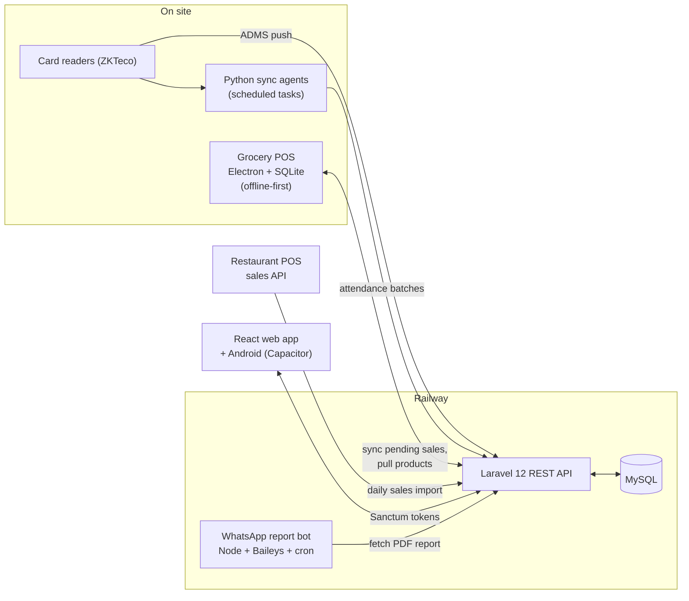

<h1>Facility Management Platform</h1>

  
  
  
  
  
  
  

An operations and finance platform I designed and built, alone, for a facility services and manpower
company in Kuwait. It runs the company's day-to-day work: staff attendance from card readers, payroll,
client invoicing, payables, double-entry accounting, kitchen costing, a grocery point of sale and
automated reports. It has been in daily production use since early 2026.

<table>
  <tr>
    <td align="center"><b>~21</b> modules</td>
    <td align="center"><b>~480</b> API routes</td>
    <td align="center"><b>103</b> data models</td>
    <td align="center"><b>4</b> integrations with hardware and external systems</td>
    <td align="center"><b>1</b> developer</td>
  </tr>
</table>

> The source code belongs to my employer and contains business data, so this repository holds the
> write-up only. I am happy to walk through the code and a demo instance on a call.

## At a glance

| | |
|---|---|
| Role | Sole developer: requirements, data model, backend, frontend, deployment, support |
| Users | Owners, accountants, HR, kitchen supervisors, read-only viewers |
| Size | ~21 modules, ~480 API routes, 48 controllers, 103 models, 136 database migrations |
| Backend | Laravel 12 (PHP 8.2), MySQL, Sanctum token auth, DomPDF, PhpSpreadsheet |
| Frontend | React + Vite, Tailwind CSS, TanStack Query, React Hook Form, Recharts |
| Mobile | Same React app packaged for Android with Capacitor |
| Integrations | ZKTeco card readers, BioTime, offline Electron POS, restaurant POS API, WhatsApp bot |
| Hosting | Railway (API, database, bot), Cloudinary (photos and documents) |

## Architecture

## Modules

**People**
- Employees: profiles, documents, passport scanning with in-browser OCR (tesseract.js), leaver tracking
- Attendance: card-reader punches ingested by push and by scheduled pull, daily grids, meal counts
- Payroll: daily-rate calculation, separate payroll scopes per business unit, approval and export

**Money**
- Client invoicing: invoices generated from monthly headcount per client, PDF output, numbering rules
- Payables: vendor bills, a monthly payables generator that copies fixed rentals forward, with preview
- Expenses: every new expense goes through a named approver with a review date
- Accounting: double-entry vouchers, chart of accounts, bank reconciliation, company receivables
- Profit and reporting: per-unit profit, scheduled reports, Excel exports

**Operations**
- Kitchen cost tracker: ingredient purchases vs. meals served, 21st-to-20th reporting periods
- Grocery POS admin: products, receiving batches, shifts, stock repair tools
- Service trips (water, sewage, diesel), generator rentals, equipment, maintenance, rooms, complaints

**Access**
- Role-based access through route-level middleware (admin, finance, invoicing, payroll approver,
  maintenance, facility manager), plus a read-only viewer and an attendance-only role for kitchen staff

## Problems worth talking about

**Offline-first POS that cannot lose a sale.** The shop's internet drops. The POS is an Electron app
that writes every sale to local SQLite first, then pushes pending sales to the API and pulls product and
price changes when it is back online. I later found that several machines writing to the same backend
created duplicate receiving batches and "phantom" stock. I traced it to the sync path, removed the bad
batch from production safely and moved the stock rules server-side so a client cannot double-apply them.

**Getting attendance out of hardware.** The card readers speak the ZKTeco ADMS protocol. The API accepts
their push requests directly, and small Python agents running as Windows scheduled tasks pull from devices
that cannot push. Both paths feed one ingestion service that de-duplicates punches, so payroll reads from
a single clean source.

**Turning spreadsheets into a system.** The company ran on dozens of Excel workbooks. I wrote parsers for
their real sheets (expenses, daily costs, rosters, headcount) to migrate history in, and Excel exports back
out so accountants keep the formats they trust.

**Reports that arrive by themselves.** A Node service using Baileys logs in to a WhatsApp number, fetches
the daily POS sales PDF from the API on a cron schedule and sends it to the owners' group.

**Money in the right units.** Payroll and invoicing work in Kuwaiti dinar with fils (3 decimals), daily
rates on a 30-day month, and rules that changed mid-year (for example a new diesel rate from a set date).
Calculations live in dedicated service classes with the rules in one place, so a rate change is a data
change, not a code hunt.

## What I would do next

- Automated tests around payroll and invoicing calculations (currently verified against the accountants'
  sheets by reconciliation scripts)
- Move remaining frontend-only permission checks to the API
- A seeded demo environment so new staff can train without touching production

## Contact

Fatima Salahuddin, BS Computer Science, FAST-NUCES Karachi
[LinkedIn](https://www.linkedin.com/in/fatima-salahuddin-/) · fatimasalahuddinmirza@gmail.com
